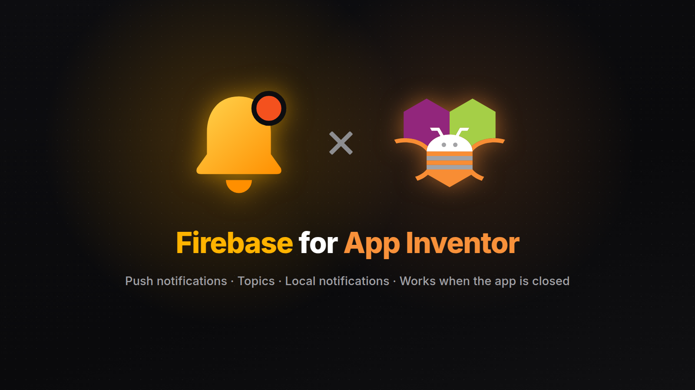
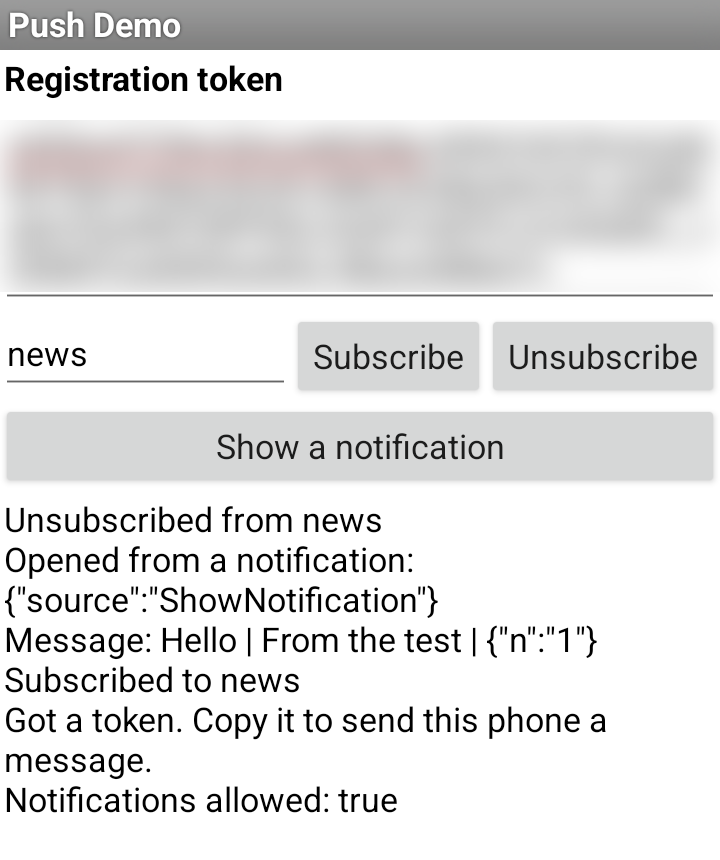

<p align="center">
  
</p>

<p align="center">
  <a href="https://github.com/zainulhassan815/firebase-appinventor/releases/latest"></a>
  <a href="LICENSE"></a>
  
  
</p>

<p align="center">
  <a href="https://github.com/zainulhassan815/firebase-appinventor/releases/latest">Download</a> ·
  <a href="docs/getting-started.md">Getting started</a> ·
  <a href="docs/messaging.md">Messaging</a> ·
  <a href="docs/sending.md">Sending</a> ·
  <a href="docs/blocks.md">Blocks</a>
</p>

A [Firebase](https://firebase.google.com) extension for MIT App Inventor and App Inventor
based platforms. It brings push notifications to your apps with Firebase Cloud
Messaging (FCM), which is free: your server, or the Firebase console,
reaches one phone or every phone that subscribed to a topic, even when the app is closed.

## Features

- **Push notifications:** messages with a title and a body show as notifications while
  your app is in the background or closed. Tapping one opens the app and hands it the
  message's data.
- **Messages in the app:** while the app is open, every message, with its data as a
  dictionary, arrives in one event.
- **Tokens and topics:** get the phone's registration token for your server, follow
  token changes, and subscribe to topics for announcements to many phones.
- **Local notifications:** show a notification from the app itself, with your own icon.
- **Notification settings:** ask for permission on Android 13 and later, and name the
  app's notification channel and choose how it interrupts.
- **Plain setup:** upload your project's `google-services.json` and select it. Any
  Android app of your Firebase project works, whatever its package name.
- **Safe by default:** the extension only receives. Sending needs your project's
  secret key, which belongs on a server, never in an app.

## Quick start

1. Create a project in the [Firebase console](https://console.firebase.google.com), add
   an Android app to it with any package name, and download its `google-services.json`.
2. Download `dev.dreamerslab.firebase.aix` from the
   [latest release](https://github.com/zainulhassan815/firebase-appinventor/releases/latest)
   and import it (Palette → Extension → Import extension).
3. Add a **FirebaseMessaging** component to Screen1, upload `google-services.json` in
   Media and select it as `GoogleServicesFile`.
4. Call `RequestNotificationPermission` and `GetToken` when the screen starts. The token
   arrives in `GotToken`.
5. Build the app, install it, and send it a test message from the console (Messaging →
   new campaign → Firebase Notification messages → Send test message).

The [getting started guide](docs/getting-started.md) walks through each step.

**The AI Companion can't run this extension:** Firebase ships as Android libraries that
the Companion can't load. Test with an APK build.

## Sample app



`PushDemo.aia` in every release shows the token, subscribes to a topic, logs every
message, and shows a local notification. Import it, upload your `google-services.json`,
select it in `FirebaseMessaging1`, and build.

Copy the token from the app and send it a message from the Firebase console, or send to
the `news` topic after tapping **Subscribe**.

<br clear="right">

## How messages arrive

| The app is… | Notification message | Data-only message |
|---|---|---|
| open, in front | `MessageReceived` | `MessageReceived` |
| in the background | shown by Android; a tap fires `NotificationOpened` | `MessageReceived` |
| closed | shown by Android; a tap fires `NotificationOpened` | dropped |

App Inventor can't run blocks without a screen, so to reach a closed app, send a
notification message, with data for the tap. [Messaging](docs/messaging.md) explains
each case.

## Components

| Component | What it does | Guide |
|---|---|---|
| **FirebaseMessaging** | Registration tokens, topics, incoming messages, notification taps and local notifications. | [Messaging](docs/messaging.md) |

Every block is shown with its description in [Blocks](docs/blocks.md). Each image
contains its block: drag it into your workspace.

## Sending messages

The extension has no blocks to send messages, on purpose: sending needs your project's
service account key, and anything inside an app can be extracted. Send from:

- the **Firebase console**, for tests and announcements;
- **your server**, through the FCM HTTP v1 API or a Firebase Admin SDK. A Supabase Edge
  Function, called with the [Supabase extension](https://github.com/zainulhassan815/supabase-appinventor),
  is one option.

[Sending](docs/sending.md) shows the requests.

## FAQ

**Which devices?** Android 7.0 and newer with Google Play services.

**Does my app's package name have to match the one in Firebase?** No. The component
uses the Android app in `google-services.json` whose package matches, or else the first
one.

**The notification shows, but `MessageReceived` didn't fire.** Android shows
notification messages itself while the app is in the background or closed, without
waking the app. The data arrives in `NotificationOpened` when the user taps it.

**Messages stopped arriving.** The user may have force-stopped the app, which blocks
messages until it's opened again. Some phone makers also do this when the app is swiped
away. Check `NotificationsEnabled` too.

**Kodular and other builders?** The extension should work on App Inventor based
builders, but so far only MIT App Inventor has been tested. Builders with their own
Firebase components may clash with it. Reports are welcome.

## Building

```
rush build
python3 samples/package.py
```

`rush build` writes the extension to `out/dev.dreamerslab.firebase.aix` with its block
reference, and `samples/package.py` packs the sample into `out/PushDemo.aia`. After
changing blocks, render their images and regenerate [docs/blocks.md](docs/blocks.md)
with `python3 docs/blocks.py`; it fails if a block has no image. GitHub Actions builds
both on every push, and a tag named after the version in `rush.yml`, like `v1.0.0`,
publishes a release.

The tests build real App Inventor apps with App Inventor's build server, run them on a
phone and send them real messages. See [Testing](docs/testing.md).

## License

[MPL-2.0](LICENSE). Use the extension in any app, free or commercial, and keep your
app's code to yourself. If you change the extension's own files and distribute them,
share those changes under the same license.

Built with [Rush](https://github.com/shreyashsaitwal/rush-cli) on the
[Firebase Android SDK](https://github.com/firebase/firebase-android-sdk). Firebase and
MIT App Inventor are trademarks of their owners; this is a community project, not an
official one.
