# Blocks

Every block of the Firebase extension. Each image contains its block, so you can drag it straight into your workspace.

- [FirebaseMessaging](#firebasemessaging)
  - [Connecting](#connecting)
  - [Token](#token)
  - [Topics](#topics)
  - [Messages](#messages)
  - [Notifications](#notifications)
  - [Errors](#errors)
- [Dropdowns](#dropdowns)

## FirebaseMessaging

Firebase Cloud Messaging: the device's registration token, topics, and the messages sent to this app. Connect it to your Firebase project with GoogleServicesFile or InitializeApp. Send messages from a server, never from the app: sending needs your project's service account key. Guide: [Messaging](messaging.md).

### Connecting

 

**GoogleServicesFile** (read-write): The google-services.json file of your Firebase project, uploaded as a media file. Any Android app of the project works: the app's package name doesn't have to match.

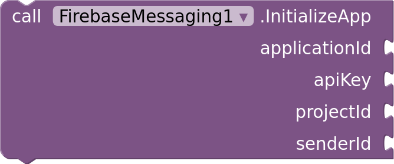

**InitializeApp:** Connects to a Firebase project without a google-services.json file. The values are in the project settings: the app ID, the Web API key, the project ID and the project number.

### Token

**GetToken:** Requests the device's registration token. Send it to your server, which uses it to send messages to this device. GotToken receives it.

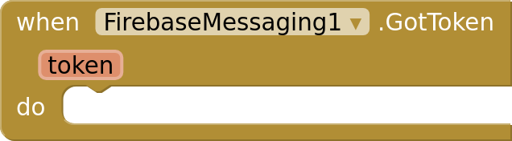

**GotToken:** The registration token GetToken requested.

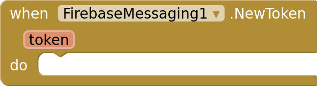

**NewToken:** Firebase created or replaced the registration token while the app was open, such as on the app's first start. Send it to your server.

**DeleteToken:** Deletes the registration token, so messages sent to it no longer arrive. GetToken creates a new one.

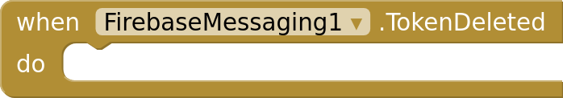

**TokenDeleted:** DeleteToken finished.

### Topics

**SubscribeToTopic:** Subscribes the device to a topic, so it receives the messages sent to it. Topic names use letters, digits and -_.~%.

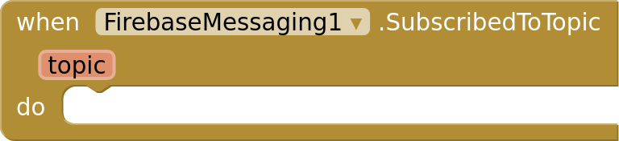

**SubscribedToTopic:** The device is subscribed to the topic.

**UnsubscribeFromTopic:** Unsubscribes the device from a topic.

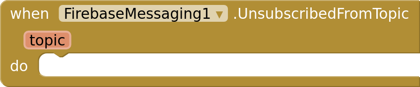

**UnsubscribedFromTopic:** The device is unsubscribed from the topic.

### Messages

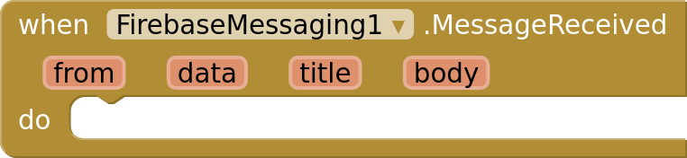

**MessageReceived:** A message arrived while the app was running. from is the sender ID or /topics/<name>, data holds the message's data, and title and body its notification, if it has one. Android shows notification messages itself only while the app is in the background.

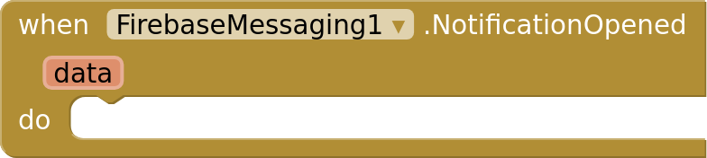

**NotificationOpened:** The app was opened by tapping a notification: one Android showed for an FCM message, or one from ShowNotification. data holds the message's data. Put this component on Screen1: notifications open the app's first screen.

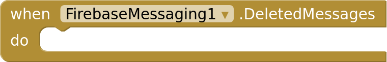

**DeletedMessages:** Firebase deleted messages that waited too long for the device. Fetch the latest state from your server.

### Notifications

**RequestNotificationPermission:** Asks the user to allow notifications. Android 13 and later need this before any notification shows. NotificationPermissionResult receives the answer.

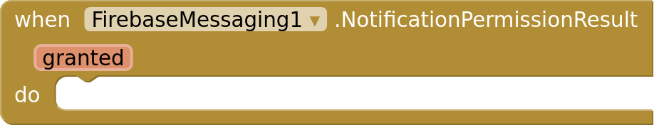

**NotificationPermissionResult:** Whether the user allowed notifications.

**NotificationsEnabled** (read-only): Whether the user allows this app's notifications.

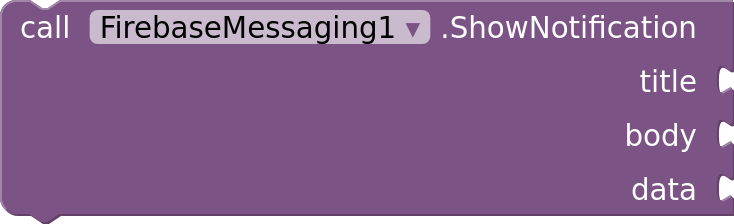

**ShowNotification:** Shows a notification. Tapping it opens the app, and NotificationOpened receives data, a dictionary of text values.

 

**ChannelName** (read-write): The name of the app's notification channel, shown in the app's notification settings. Notifications from ShowNotification and from FCM messages use this channel.

 

**ChannelImportance** (read-write): How the channel's notifications interrupt the user. Android applies it when the channel is first created: after that, only the user can change it, in the app's settings.

 

**NotificationIcon** (read-write): A media file shown as ShowNotification's icon in the status bar: a white shape on a transparent background. Without one, notifications use the app icon.

### Errors

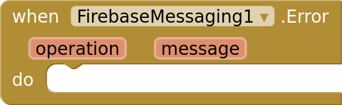

**Error:** An operation failed. Without this event, the screen's ErrorOccurred event receives the error.

## Dropdowns

**ChannelImportance:** Min, Low, Default, High
