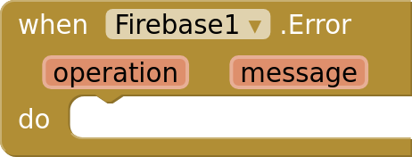
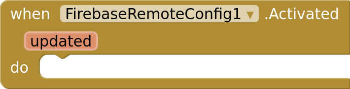
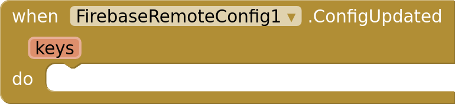
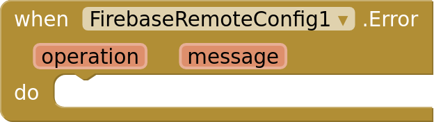

# Blocks

Every block of the Firebase extension. Each image contains its block, so you can drag it straight into your workspace.

- [Firebase](#firebase)
  - [Connecting](#firebase-connecting)
  - [Errors](#firebase-errors)
- [FirebaseMessaging](#firebasemessaging)
  - [Project](#firebasemessaging-project)
  - [Token](#firebasemessaging-token)
  - [Topics](#firebasemessaging-topics)
  - [Messages](#firebasemessaging-messages)
  - [Notifications](#firebasemessaging-notifications)
  - [Errors](#firebasemessaging-errors)
- [FirebaseRemoteConfig](#firebaseremoteconfig)
  - [Project](#firebaseremoteconfig-project)
  - [Fetching](#firebaseremoteconfig-fetching)
  - [Values](#firebaseremoteconfig-values)
  - [Live updates](#firebaseremoteconfig-live-updates)
  - [Errors](#firebaseremoteconfig-errors)
- [Dropdowns](#dropdowns)

## Firebase

Connects the app to your Firebase project. The other Firebase components use it through their Firebase property. Guide: [Connecting](connecting.md).

### Firebase: Connecting

 

**GoogleServicesFile** (read-write): The google-services.json file of your Firebase project, uploaded as a media file. Any Android app of the project works: the app's package name doesn't have to match.

**InitializeApp:** Connects to a Firebase project without a google-services.json file. The values are in the project settings: the app ID, the Web API key, the project ID and the project number.

**ProjectId** (read-only): The ID of the connected Firebase project, or empty before it connects.

### Firebase: Errors

**Error:** Connecting failed. Without this event, the screen's ErrorOccurred event receives the error.

## FirebaseMessaging

Firebase Cloud Messaging: the device's registration token, topics, and the messages sent to this app. Set its Firebase property to the Firebase component. Send messages from a server, never from the app: sending needs your project's service account key. Guide: [Messaging](messaging.md).

### FirebaseMessaging: Project

 

**Firebase** (read-write): The Firebase component that connects to your project.

### FirebaseMessaging: Token

**GetToken:** Requests the device's registration token. Send it to your server, which uses it to send messages to this device. GotToken receives it.

**GotToken:** The registration token GetToken requested.

**NewToken:** Firebase created or replaced the registration token while the app was open, such as on the app's first start. Send it to your server.

**DeleteToken:** Deletes the registration token, so messages sent to it no longer arrive. GetToken creates a new one.

**TokenDeleted:** DeleteToken finished.

### FirebaseMessaging: Topics

**SubscribeToTopic:** Subscribes the device to a topic, so it receives the messages sent to it. Topic names use letters, digits and -_.~%.

**SubscribedToTopic:** The device is subscribed to the topic.

**UnsubscribeFromTopic:** Unsubscribes the device from a topic.

**UnsubscribedFromTopic:** The device is unsubscribed from the topic.

### FirebaseMessaging: Messages

**MessageReceived:** A message arrived while the app was running. from is the sender ID or /topics/<name>, data holds the message's data, and title and body its notification, if it has one. Android shows notification messages itself only while the app is in the background.

**NotificationOpened:** The app was opened by tapping a notification: one Android showed for an FCM message, or one from ShowNotification. data holds the message's data. Put this component on Screen1: notifications open the app's first screen.

**DeletedMessages:** Firebase deleted messages that waited too long for the device. Fetch the latest state from your server.

### FirebaseMessaging: Notifications

**RequestNotificationPermission:** Asks the user to allow notifications. Android 13 and later need this before any notification shows. NotificationPermissionResult receives the answer.

**NotificationPermissionResult:** Whether the user allowed notifications.

**NotificationsEnabled** (read-only): Whether the user allows this app's notifications.

**ShowNotification:** Shows a notification. Tapping it opens the app, and NotificationOpened receives data, a dictionary of text values.

 

**ChannelName** (read-write): The name of the app's notification channel, shown in the app's notification settings. Notifications from ShowNotification and from FCM messages use this channel.

 

**ChannelImportance** (read-write): How the channel's notifications interrupt the user. Android applies it when the channel is first created: after that, only the user can change it, in the app's settings.

 

**NotificationIcon** (read-write): A media file shown as ShowNotification's icon in the status bar: a white shape on a transparent background. Without one, notifications use the app icon.

### FirebaseMessaging: Errors

**Error:** An operation failed. Without this event, the screen's ErrorOccurred event receives the error.

## FirebaseRemoteConfig

Firebase Remote Config: values you change in the Firebase console, such as texts, numbers and feature switches, without publishing a new version of the app. Set its Firebase property to the Firebase component. Guide: [Remote Config](remote-config.md).

### FirebaseRemoteConfig: Project

 

**Firebase** (read-write): The Firebase component that connects to your project.

### FirebaseRemoteConfig: Fetching

**SetDefaults:** Sets the values used for keys that Firebase has no value for, such as before the first fetch or without a connection. Values are texts, numbers, booleans, lists or dictionaries.

**FetchAndActivate:** Fetches the latest values from Firebase and activates them. Activated receives whether any value changed.

**Fetch:** Fetches the latest values from Firebase without using them yet, so values don't change while the user looks at them. Fetched fires when they are ready: call Activate, for example the next time the app starts.

**Fetched:** Fetch finished. Call Activate to use the fetched values.

**Activate:** Uses the values fetched last. Activated receives whether any value changed.

**Activated:** The fetched values are in use. updated is true when any value changed.

 

**MinimumFetchInterval** (read-write): How many seconds fetched values stay fresh. Fetch and FetchAndActivate only contact Firebase when the last fetch is older. Firebase limits how often an app may fetch: keep 12 hours (43200) in published apps, and use 0 while you develop.

### FirebaseRemoteConfig: Values

**GetString:** The value of key as text, or empty text if it has none.

**GetNumber:** The value of key as a number, or 0 if it has none or isn't a number.

**GetBoolean:** The value of key as a boolean, such as true, yes or 1. False if it has none.

**GetJson:** The value of key read as JSON: a dictionary, a list, or a single value. Empty text if it has none or isn't valid JSON.

**GetAll:** Every key with a value, from Firebase or the defaults, as a dictionary of texts.

### FirebaseRemoteConfig: Live updates

 

**ListenForUpdates** (read-write): Whether to listen for values published in the Firebase console while the app is open. ConfigUpdated fires when new values have been fetched: call Activate to use them.

**ConfigUpdated:** New values were published and fetched while the app was open. keys lists the keys that changed. Call Activate to use them.

### FirebaseRemoteConfig: Errors

**Error:** An operation failed. Without this event, the screen's ErrorOccurred event receives the error.

## Dropdowns

**ChannelImportance:** Min, Low, Default, High
