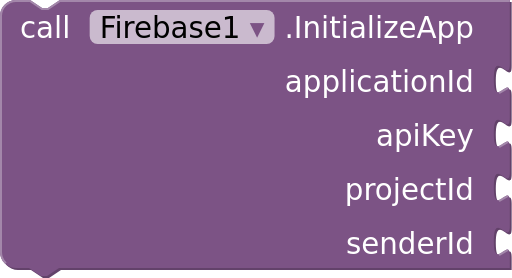

# Connecting

The `Firebase` component connects the app to your Firebase project. Add one to each
screen that uses Firebase, and set the `Firebase` property of the other Firebase
components on that screen to it.

## google-services.json

Set `GoogleServicesFile` to your project's `google-services.json`, uploaded in Media.
The component connects when the screen starts.

To get the file, open Project settings → General in the
[Firebase console](https://console.firebase.google.com), add an Android app if the
project has none, and download `google-services.json`. Any package name works. The file
may list several Android apps: the component uses the one whose package name matches
your app, or else the first one.

## Without the file

`InitializeApp(applicationId, apiKey, projectId, senderId)` connects with the four
values from the file, for apps that keep them elsewhere. They're in Project settings →
General: the app ID (`1:…:android:…`), the Web API key, the project ID and the project
number. Call it in `Screen.Initialize`, before the other components' blocks.

## Good to know

- `ProjectId` is the connected project's ID, or empty until the component connects.
- An app connects to one Firebase project. Connecting to a second one fails with
  `Firebase is already connected to project …`.
- If you restrict your API key in the Google Cloud console to Android apps, its package
  name and signing certificate must match your app's.
- Connection failures fire the component's `Error(operation, message)`, or
  `Screen.ErrorOccurred` without a handler. Blocks of other components used before the
  connection fail with `Set the Firebase component's GoogleServicesFile or call its
  InitializeApp first`, and those without a `Firebase` property set with
  `Set the Firebase property`.
- The values in `google-services.json` aren't secret: they identify your project, and
  every app built with Firebase contains them. Your project's security comes from its
  rules and from never shipping the service account key.
