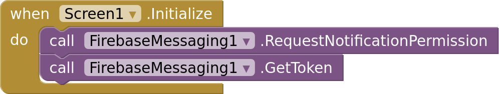
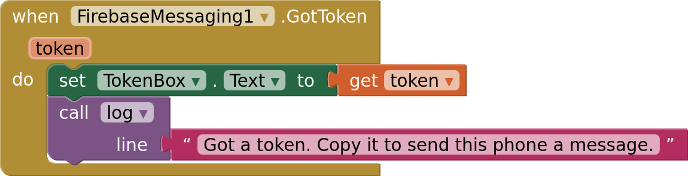
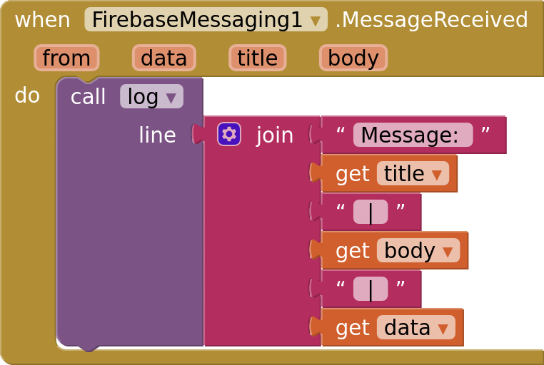

# Getting started

This guide connects an app to Firebase, gets the phone's registration token, and sends
the phone a push notification from the Firebase console. It takes about ten minutes.

## 1. Create a Firebase project

1. Open the [Firebase console](https://console.firebase.google.com) and create a
   project. Google Analytics isn't needed.
2. Add an **Android** app to the project. Any package name works, such as
   `appinventor.ai_yourname.PushDemo`: the extension doesn't require it to match your
   app's.
3. Download `google-services.json` when the console offers it. Skip the remaining
   steps about Gradle and SDKs: the extension does that part.

You can download the file again later from Project settings → General → Your apps.

## 2. Add the extension

1. Download `dev.dreamerslab.firebase.aix` from the
   [latest release](https://github.com/zainulhassan815/firebase-appinventor/releases/latest).
2. In App Inventor, open Palette → Extension → **Import extension** and choose the file.
3. Drag a **FirebaseMessaging** component onto Screen1. Keep it on Screen1: tapping a
   notification opens the app's first screen.
4. Upload `google-services.json` in Media, and select it as the component's
   `GoogleServicesFile`.

## 3. Get the token

Every installed copy of your app has a registration token, a long text that identifies it
to Firebase. Your server sends messages to it.

`RequestNotificationPermission` asks the user to allow notifications, which Android 13
and later require. `GetToken` requests the token, which arrives in `GotToken`:

The sample shows the token in a text box so you can copy it. A real app sends it to its
server instead, for example into a Supabase table next to the signed-in user.

## 4. Build and install

Build the app (Build → Android App) and install it. **The AI Companion can't run this
extension:** Firebase ships as Android libraries that the Companion can't load.

Open the app and allow notifications. The token appears.

## 5. Send a message

1. In the Firebase console, open **Messaging** and create a new campaign of the
   **Firebase Notification messages** kind.
2. Enter a title and a text, then choose **Send test message**.
3. Paste the token and send.

With the app open, nothing shows on the phone: Android leaves messages to the app while
it's in front, and `MessageReceived` fires:

Press Home and send again. This time the notification appears, even after the app is
closed. Tapping it opens the app and fires `NotificationOpened`.

## Next

- [Messaging](messaging.md) explains topics, the kinds of messages and what happens in
  each app state, and local notifications.
- [Sending](sending.md) shows how your own server sends messages.
- [Blocks](blocks.md) lists every block.
- The `PushDemo.aia` sample in every release has all of this ready to build: upload your
  `google-services.json` and select it in `FirebaseMessaging1`.
