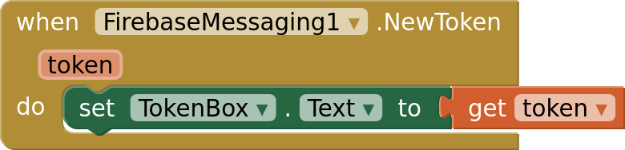
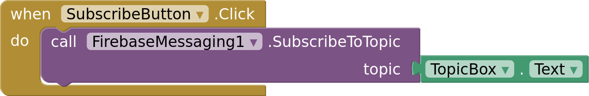
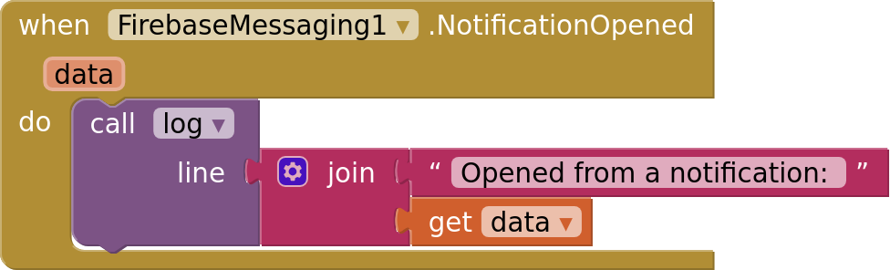
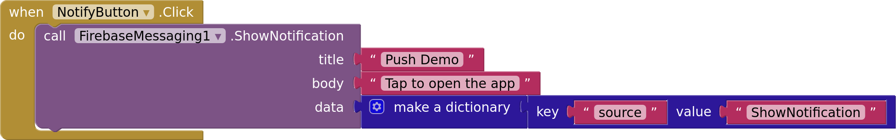
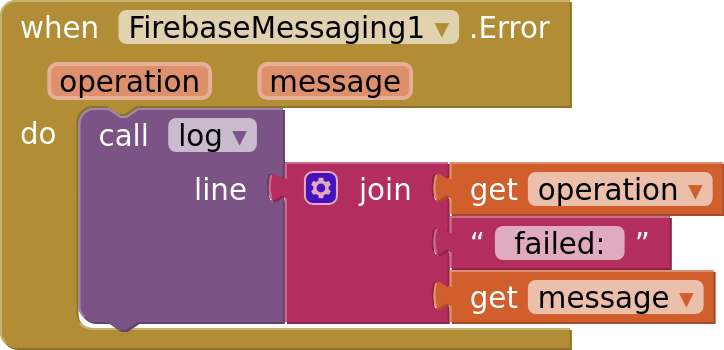

# Messaging

`FirebaseMessaging` receives [Firebase Cloud Messaging](https://firebase.google.com/docs/cloud-messaging)
(FCM) messages: push notifications and data that your server sends to one phone, or to
every phone subscribed to a topic.

- [Connecting](#connecting)
- [Tokens](#tokens)
- [Topics](#topics)
- [Messages](#messages)
- [Notifications](#notifications)
- [Errors](#errors)
- [Limits](#limits)

## Connecting

Set `GoogleServicesFile` to your project's `google-services.json`, uploaded in Media. The
component connects when the screen starts. The file may list several Android apps: the
component uses the one whose package name matches your app, or else the first one. The
package name never has to match.

`InitializeApp(applicationId, apiKey, projectId, senderId)` connects without the file,
for apps that keep these values elsewhere. They're in Project settings → General: the
app ID (`1:…:android:…`), the Web API key, the project ID and the project number.

An app connects to one Firebase project. Connecting to a second one fails with
`Firebase is already connected to project …`.

If you restrict your API key in the Google Cloud console to Android apps, its package
name and signing certificate must match your app's.

## Tokens

`GetToken` requests the registration token, which `GotToken` receives. Send it to your
server, which uses it to address this phone. The token stays the same across app
starts, so request it at every start and update the server when it differs.

Firebase can replace the token, for example after the app's data is cleared. When that
happens while the app is open, `NewToken` fires with the new one. It also fires on the
app's first start, when the token is created.

`DeleteToken` deletes the token, so messages sent to it no longer arrive, and
`TokenDeleted` fires. Use it when a user signs out. `GetToken` then creates a new one.

## Topics

A topic is a name that phones subscribe to. A message sent to a topic reaches every
subscribed phone, so your server doesn't need to keep tokens for announcements.

`SubscribeToTopic` subscribes and `SubscribedToTopic` confirms it.
`UnsubscribeFromTopic` and `UnsubscribedFromTopic` undo it. Topic names use letters,
digits and `-_.~%`. Subscriptions belong to the token: they last across app starts,
and deleting the token removes them.

Anyone can subscribe to any topic, so don't send private content to one.

## Messages

An FCM message has two optional parts:

- **notification:** a title and a body, which Android shows as a notification;
- **data:** keys and text values for your app.

What the phone does depends on the parts and on the app's state:

| The app is… | Notification message (may also carry data) | Data-only message |
|---|---|---|
| open, in front | `MessageReceived`, nothing is shown | `MessageReceived` |
| in the background | Android shows the notification | `MessageReceived` |
| closed | Android shows the notification | dropped |

`MessageReceived(from, data, title, body)` gets the sender ID, or `/topics/<name>` for
a topic message, the data as a dictionary, and the notification's title and body, empty
for data messages.

To reach a closed app, send a notification message. App Inventor can't run blocks
without a screen, so a data-only message to a closed app is dropped, as in any app
that uses FCM.

Tapping a notification opens the app and fires `NotificationOpened` with the message's
data. If the app was in the background, Screen1 starts again, so
`Screen1.Initialize` runs first.

Use the data to open what the message was about, such as a chat. FCM's own keys, like
`google.message_id`, are removed.

`DeletedMessages` fires when FCM dropped messages that waited too long for an offline
phone. Load the latest state from your server.

## Notifications

**Permission.** Android 13 and later show notifications only after the user allows
them. `RequestNotificationPermission` asks, and `NotificationPermissionResult(granted)`
receives the answer. On older versions it reports whether notifications are on.
`NotificationsEnabled` tells whether they are on right now: users can turn them off in
the app's settings at any time.

**Channel.** Android groups an app's notifications into channels, which users control
in the app's settings. The component uses one channel for its own notifications and for
FCM's: `ChannelName` is the name users see, and `ChannelImportance` sets how
notifications interrupt them:

| ChannelImportance | Effect |
|---|---|
| `Min` | Only in the notification shade, collapsed |
| `Low` | In the status bar, silent |
| `Default` | In the status bar, with sound |
| `High` | Also pops up on the screen |

Android applies the importance only when the channel is first created. After that only
the user can change it. To try another importance, uninstall the app first.

**Local notifications.** `ShowNotification(title, body, data)` shows a notification
from the app itself, without a server. Tapping it fires `NotificationOpened` with
`data`, a dictionary of text values.

**Icon.** `NotificationIcon` sets the status bar icon of `ShowNotification`'s
notifications: a PNG with a white shape on a transparent background. Without it, they
use the app icon. Notifications Android shows for FCM messages always use the app icon.

## Errors

Blocks that fail fire `Error(operation, message)`, where `operation` is the block's
name, such as `GetToken`. Without an `Error` handler, `Screen.ErrorOccurred` fires
instead.

Common causes: `GoogleServicesFile` isn't set, the phone is offline, or Google Play
services is missing or out of date.

## Limits

- **APK builds only.** The AI Companion can't load Firebase's libraries.
- **Android 7.0 or newer**, with Google Play services. Phones without them, such as
  Huawei phones sold since 2019, get no token.
- **Force stop.** After the user force-stops the app from its settings, Android
  delivers nothing until the app is opened again. Some phone makers do the same when
  the app is swiped away from recent apps.
- **No sending from the app.** See [Sending](sending.md).
