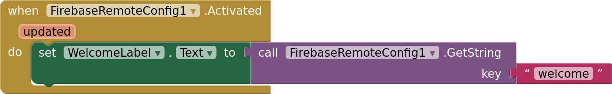
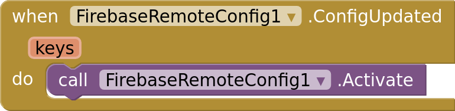

# Remote Config

`FirebaseRemoteConfig` reads values you set in the Firebase console, such as a welcome
text, a price, or a switch that turns a feature on, so you can change them without
publishing a new version of the app. It's free, and Firebase can serve different values
to different users with conditions, such as by country, language or app version.

- [Setup](#setup)
- [Defaults](#defaults)
- [Fetching](#fetching)
- [Reading values](#reading-values)
- [Live updates](#live-updates)
- [Errors](#errors)

## Setup

1. Add a `FirebaseRemoteConfig` component and set its `Firebase` property to your
   `Firebase` component. See [Connecting](connecting.md).
2. In the [Firebase console](https://console.firebase.google.com), open **Remote
   Config**, add parameters, and publish the changes. A parameter is a key, such as
   `welcome`, and its value.

## Defaults

`SetDefaults` gives every key a value to use until Firebase has sent one: on the first
start, offline, or for keys you haven't added in the console. Call it in
`Screen.Initialize`, with a dictionary of texts, numbers, booleans, lists or
dictionaries.

The defaults belong to the component: call `SetDefaults` on every start.

## Fetching

`FetchAndActivate` downloads the latest values and puts them in use. `Activated(updated)`
fires when they're ready, with `updated` true if any value changed. Read your values
there:

Activated values are saved on the phone, so the next start reads them right away, even
before fetching.

To keep values from changing while the user looks at them, fetch now and use the values
on the next start: `Fetch` downloads them and `Fetched` fires; `Activate` puts the last
fetched values in use.

**How often.** `MinimumFetchInterval` is how long, in seconds, fetched values stay fresh:
`Fetch` and `FetchAndActivate` only contact Firebase when the last fetch is older. The
default is 12 hours (43200), which Firebase recommends for published apps: Firebase
limits how often each app may fetch. Set it to 0 while you develop, so every fetch gets
your latest changes.

## Reading values

| Block | Returns | Without a value |
|---|---|---|
| `GetString(key)` | the value as text | empty text |
| `GetNumber(key)` | the value as a number | 0 |
| `GetBoolean(key)` | true for `true`, `yes`, `on`, `1`, `t` and `y`, false for their opposites | false |
| `GetJson(key)` | a JSON value read as a dictionary, list, text or number | empty text |
| `GetAll()` | every key with a value, as a dictionary of texts | |

Each block returns the activated value from Firebase if there is one, or else the
default. A value that isn't a number for `GetNumber`, or not a boolean or valid JSON,
returns the fallback and fires `Error`.

In the console, parameters have a type (String, Number, Boolean or JSON), but every
value reaches the app as text: the block you use decides how it's read.

## Live updates

With `ListenForUpdates` on, the component listens for changes you publish in the
console while the app is open. When one arrives, Firebase fetches it and
`ConfigUpdated(keys)` fires with the keys that changed. Call `Activate` to use them:

A change can take a few minutes to reach the app. Live updates ignore
`MinimumFetchInterval`.

## Errors

Blocks that fail fire `Error(operation, message)`. Without an `Error` handler,
`Screen.ErrorOccurred` fires instead. When a fetch fails, the component keeps the
values it has: the last activated ones, or the defaults.
